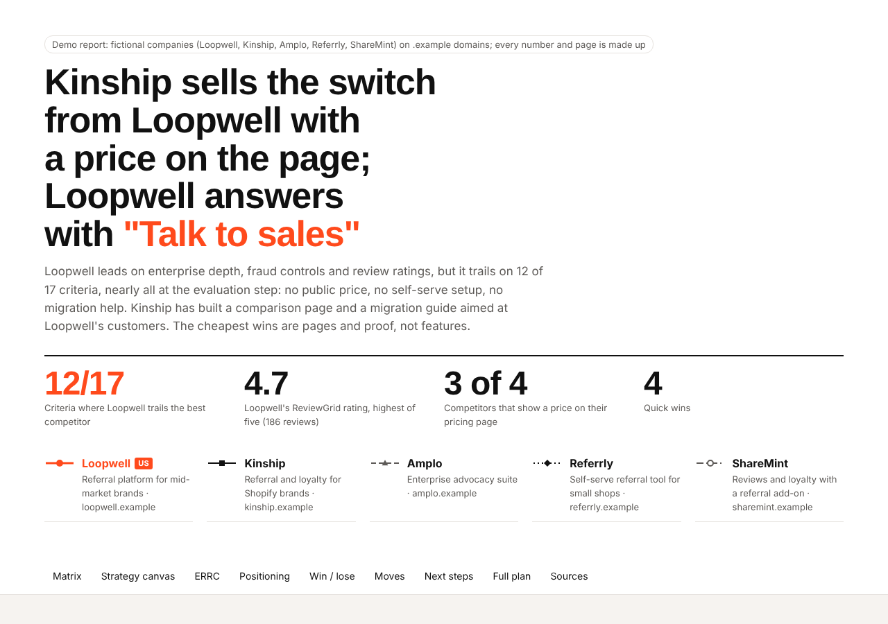
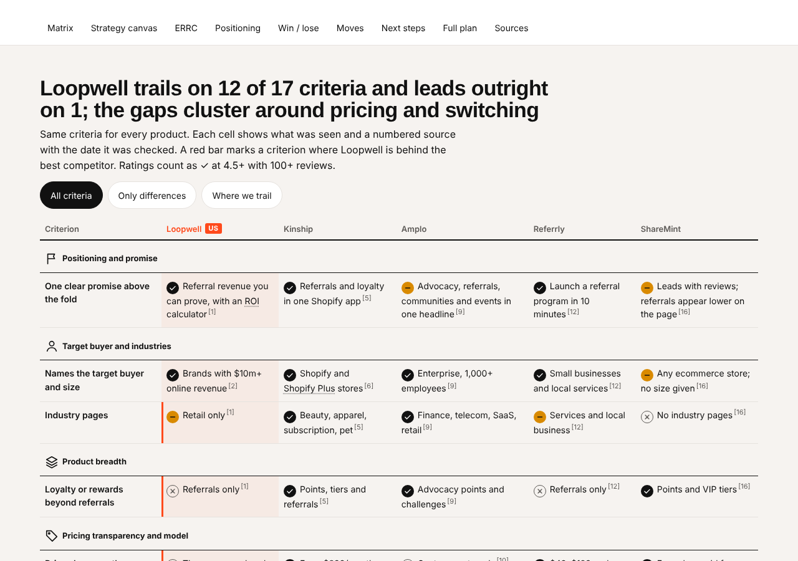
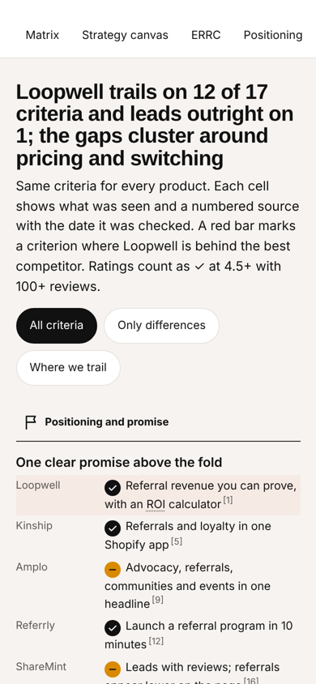
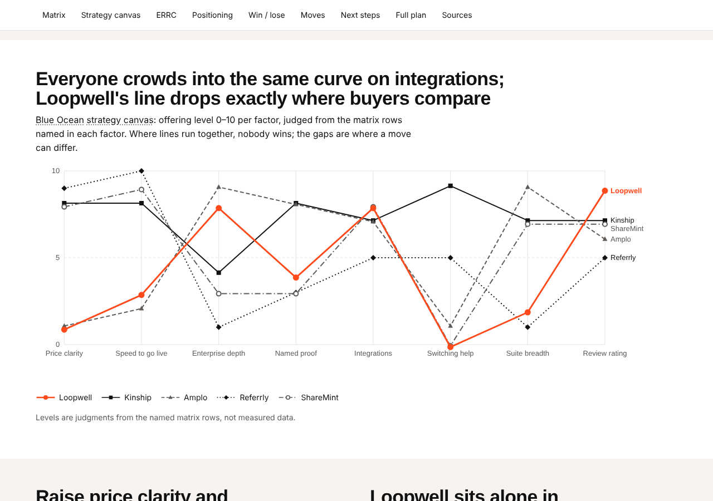
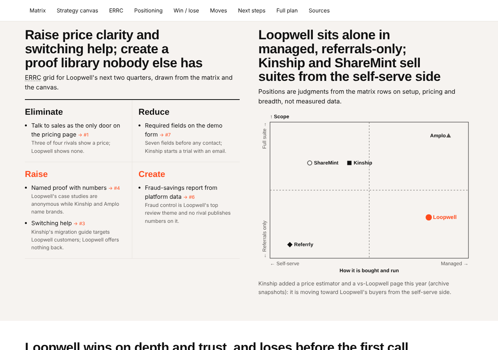

# Competitor Teardown

A Claude skill that compares your product with up to five competitors from **public pages and review sites**, through the same **12 lenses** for every product, and turns the gaps into a short list of concrete moves. Every cell in the comparison cites a URL and the date it was checked.

One `audit.json` feeds **two outputs**:

1. **A report for people**: comparison matrix, Blue Ocean strategy canvas, ERRC grid, positioning map, where we win and where we lose, and ICE-ranked moves with a full plan.
2. **A hands-off file for AI agents**: `handoff.md` + `tasks.json` with context, rules, and every move as a task (competitor evidence, steps, acceptance criteria, how to verify), ordered by ICE with dependencies first.

**Live demo:** [English report](https://claude.ai/artifact/SHTuw2y1ofKtEzbpHR2QVM) (fictional companies on `.example` domains, made-up data) · [hands-off file](plugins/competitor-teardown/skills/competitor-teardown/assets/example-handoff.en.md).

A companion to [product-lens-audit](https://github.com/artemhorbenko/product-lens-audit): same report design, same process, same two outputs.



### The 12 lenses (same for every product, ours included)

| Lens | What it checks |
|---|---|
| **Positioning and promise** | The one-line promise, and whether a number backs it |
| **Target buyer and industries** | Size bands, roles, industry pages |
| **Product breadth** | One module or a suite (loyalty, influencer, reviews...) |
| **Pricing transparency and model** | Public price, app-store price, trial, contract terms |
| **Proof** | Named customers with result numbers; sourced claims |
| **Comparison and switching pages aimed at us** | "X vs us", alternatives pages, migration guides, and what they claim about us |
| **Onboarding and time to value** | Stated go-live time, self-serve start, G2 "time to implement" |
| **Integrations and ecosystem** | Platform apps, API docs, webhooks, **MCP server** |
| **Reviews** | G2, Capterra, Software Advice, app stores: rating, count, themes, with the date |
| **Content and SEO footprint** (light) | Tranco rank, topic hubs; not a deep SEO audit |
| **Hiring and funding signals** | Careers page, Crunchbase or press |
| **Changes over time** | Wayback Machine snapshots: price, headline, new pages |

### Rules the scripts enforce

- Every matrix cell has a **source with a URL and a checked-on date**, or is `nd` (no data). No guessing.
- **One vendor's words about another are a claim**, not a fact: a cell about product A that cites product B's page must be marked `claim: true` and shows "(per B)".
- **Quotes up to 15 words**; everything else is paraphrased.
- Every move lists the **competitor evidence** behind it; the top 3 also need alternatives, a risk type, a success threshold and a pre-mortem.
- Public sources only: no sign-ups, trials, demo requests or contacting competitors.

<p>


</p>





## How it works

1. **Checks connected sources** (browser, web search, Similarweb, Ahrefs, Crunchbase, CRM) and marks each used, partial or missing.
2. **Asks up to 4 skippable questions**: our product, the competitors, the buyer, and what decision this informs.
3. **Gathers the same pages for every product**: homepage, pricing, product, integrations, docs, customers, comparison pages, careers; then G2, Capterra, app stores, Tranco, funding, and Wayback snapshots from a year ago.
4. **Builds the matrix** (12-24 criteria, ✓ / ◐ / ✗ / no data, a source per cell), then the strategy canvas, ERRC grid, positioning map and where we win / lose.
5. **Turns gaps into moves** (page, message, pricing, feature, content, proof, sales, data), labels each observed or hypothesis, scores ICE, and writes alternatives, an experiment and a pre-mortem for the top 3.
6. **Writes one `audit.json`**, validates it, builds the report and the hands-off file. Claude writes only data; the template draws everything.
7. **Render check** on desktop, tablet and phone, including dark mode.
8. **Fact check of every cell** against its source, in Claude Code by a separate subagent that has not seen the reasoning.

## Install

### Claude Code (terminal, desktop app, VS Code)

```
/plugin marketplace add artemhorbenko/competitor-teardown
/plugin install competitor-teardown@competitor-teardown
```

Then ask, for example: *"Compare acme.com with its three main competitors; public pages only. The decision is our pricing page."*

### Claude app (claude.ai, desktop, mobile)

1. Download `competitor-teardown-skill.zip` from this repository ([direct download](https://github.com/artemhorbenko/competitor-teardown/raw/main/competitor-teardown-skill.zip)).
2. Make sure code execution is on (Settings → Capabilities).
3. Go to **Customize → Skills**, click **+**, then **Create skill → Upload a skill**, and choose the ZIP.

See Anthropic's guide: [Use skills in Claude](https://support.claude.com/en/articles/12512180-use-skills-in-claude).

### Any other agent that reads SKILL.md

Copy `plugins/competitor-teardown/skills/competitor-teardown/` into your agent's skills folder.

## Better results with more access

| Source | Options |
|---|---|
| Browser | Claude in Chrome or any browser tool (needed for pricing estimators, G2 and app stores) |
| Traffic and SEO | Similarweb, Ahrefs, Semrush connectors |
| Company data | Crunchbase |
| Your own data | CRM win/loss reasons by competitor; one sentence about lost deals often beats every public page |

## Build and check a report yourself

```
S=plugins/competitor-teardown/skills/competitor-teardown
python $S/scripts/validate_audit.py audit.json               # data and rules, standard library only
python $S/scripts/build_report.py audit.json report.html
python $S/scripts/build_handoff.py audit.json handoff.md --json tasks.json
pip install playwright && playwright install chromium
python $S/scripts/check_report.py report.html --out ./report-check
```

Start from `$S/assets/example-teardown.en.json`; the shape is in `$S/references/audit.schema.json`. The render check fails on page errors, sideways scroll, empty charts, a missing canvas line, overlapping or cut-off chart labels, source links that point nowhere, broken phone table cells, tooltips that do not open on hover or tap, and filters that break a table.

## Privacy and fairness

- Public sources only, read-only. The skill does not sign up, request demos or contact anyone at a competitor.
- Competitors are judged on the same criteria and depth as your own product.
- No invented numbers, customers, reviews or prices; one vendor's statements about another are shown as claims.
- Real teardowns stay private: the evals log records scenarios and scores, not names.

## Repository layout

```
.claude-plugin/marketplace.json        marketplace catalog (this repo)
plugins/competitor-teardown/
  .claude-plugin/plugin.json
  skills/competitor-teardown/
    SKILL.md                           the process
    references/lenses.md               the 12 lenses, where to look, how to judge a cell
    references/data-sources.md         sources, status and kind, claims vs facts
    references/report-spec.md          report sections, tooltips, phone tables
    references/audit.schema.json       shape of the data
    assets/report-template.html        the report page; renders from one JSON block
    assets/example-teardown.en.json    full example (fictional companies)
    assets/example-handoff.en.md       the matching hands-off file
    scripts/validate_audit.py          data and rule check
    scripts/build_report.py            audit.json -> report.html
    scripts/build_handoff.py           audit.json -> handoff.md (+ tasks.json) for AI agents
    scripts/check_report.py            headless render check
evals/                                 scenarios, trigger prompts, results log
docs/                                  screenshots
competitor-teardown-skill.zip          the skill packaged for upload to the Claude app
```

## Credits

Ideas, not text: Blue Ocean Strategy, the strategy canvas and the ERRC grid (Kim & Mauborgne); ICE scoring (Sean Ellis); opportunity solution tree, risk types and success thresholds (Teresa Torres); pre-mortem (Gary Klein). Report design and process from [product-lens-audit](https://github.com/artemhorbenko/product-lens-audit).

## License

MIT - see [LICENSE](LICENSE).

---

## Українською

**Competitor Teardown** — скіл для Claude, який порівнює ваш продукт із 1–5 конкурентами за публічними сторінками й сайтами відгуків. Усі продукти, включно з вашим, проходять ті самі 12 лінз: позиціонування й обіцянка, цільовий покупець і галузі, ширина продукту, прозорість і модель цін, докази, порівняльні сторінки проти вас, онбординг і час до цінності, інтеграції та екосистема (API, MCP), відгуки (G2, Capterra, Software Advice, магазини застосунків), легкий SEO-слід (Tranco, теми), найм і фінансування, зміни з часом (Wayback Machine).

**Демо:** [звіт англійською](https://claude.ai/artifact/SHTuw2y1ofKtEzbpHR2QVM) (вигадані компанії, умовні дані) · [hands-off файл](plugins/competitor-teardown/skills/competitor-teardown/assets/example-handoff.en.md).

**Два результати з одного `audit.json`:**
- **Звіт для людей:** матриця порівняння з джерелом і датою перевірки в кожній клітинці, Blue Ocean strategy canvas, сітка ERRC, карта позиціонування, «де виграємо / де програємо», ходи за ICE і повний план.
- **Hands-off для AI-агентів:** `handoff.md` + `tasks.json` — контекст, правила, задачі з доказами з боку конкурентів, кроками, критеріями приймання й способом перевірки; порядок за ICE, залежності першими.

**Правила, які перевіряють скрипти:** кожна клітинка — з URL і датою або «немає даних»; слова одного вендора про іншого — це твердження, а не факт; цитати до 15 слів; кожен хід спирається на докази з боку конкурентів; лише публічні джерела, без реєстрацій і демо-запитів.

Встановлення в Claude Code:

```
/plugin marketplace add artemhorbenko/competitor-teardown
/plugin install competitor-teardown@competitor-teardown
```

Для Claude app завантажте ZIP з репозиторію ([пряме завантаження](https://github.com/artemhorbenko/competitor-teardown/raw/main/competitor-teardown-skill.zip)), потім **Customize → Skills → + → Create skill → Upload a skill**.
